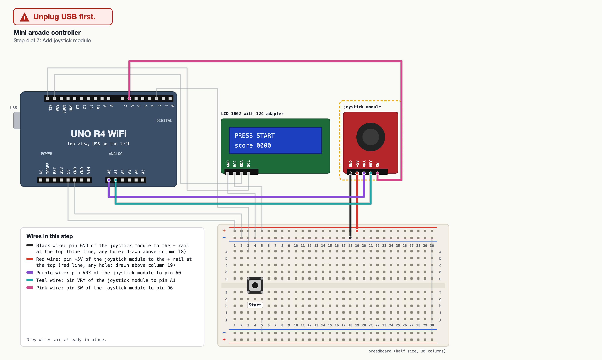

# breadboard-wiring-guide

A Claude Code skill that walks a beginner through wiring a breadboard for an
Arduino UNO, one step at a time, with a generated diagram for every step and
a clear call on each one: unplug USB first, or USB can stay plugged in.



> **Independent project.** Not affiliated with or endorsed by Arduino.
> Arduino and UNO are trademarks of their owner; board and module names are
> used only to say what the skill works with.

## What it does

- Asks first: which board, which parts, what is already wired, pins picked
  for you or chosen by you, language and image format.
- Writes a small JSON spec, then a script places the parts on a half-size
  breadboard, routes every jumper without overlaps, picks resistor values for
  the board's pin current limit and decides the USB call of every step.
- Hands over one image per step (new wires in colour, earlier ones grey, the
  new part highlighted), an overview, a Markdown guide (with the jumper wires
  and resistors you need, 4-band and 5-band colour codes) and a `plan.json`.
- Walks you through the steps in chat, one at a time, each opening with the
  USB line. It can compare a photo of your bench with the plan.

Boards: UNO R3, UNO R4 Minima, UNO R4 WiFi. Parts: push button, LED,
potentiometer, passive buzzer, speaker (with series resistor), LCD 1602 with
I2C adapter, joystick module, HC-SR04 distance sensor, PIR motion sensor.

What it never does: mains voltage, motors, servos, LED strips, relays,
batteries, 3.3 V boards, and it never uploads code to your board unless you
ask.

## The intake questions

1. Which board do you have (UNO R3, UNO R4 Minima, UNO R4 WiFi)?
2. Which parts do you want to connect, and what is already wired and working?
3. Should the pins be picked for you, or do you need specific ones?
4. Guide language (English or Italian built in) and PNG or SVG images?

## The USB rule

Power wires (5V, GND, the + and - rails, module VCC and GND) and whole
modules: unplug USB first. Signal wires only (D pins, A pins, SDA, SCL), on
parts that are already powered: USB can stay plugged in. The script makes
this call for every step; a spec can make a step stricter, never looser.

Two habits the guide asks for before the first wire: power the board only
from USB (nothing in the DC jack or on VIN), and upload an empty sketch
(BareMinimum) so that no old sketch drives a pin you are wiring.

## Install

```bash
git clone https://github.com/Matteoikarieth96/breadboard-wiring-guide-skill ~/.claude/skills/breadboard-wiring-guide
```

Requirements:

- Python 3.9 or newer (standard library only)
- macOS or Linux (tested in CI). Windows is untested.
- Optional, for PNG images: Google Chrome or Chromium. Without it you get
  SVG files, which any browser opens. `CHROME_PATH` can point at another
  install (an absolute path). PNGs take a few seconds per image.

## Usage

In Claude Code, just ask:

> I have an UNO R4 WiFi, a button, an LCD with I2C and a joystick. How do I
> wire them?

You can also run the script yourself, from the skill folder:

```bash
cd ~/.claude/skills/breadboard-wiring-guide
python3 scripts/wiring.py parts
python3 scripts/wiring.py check examples/night-light.json
python3 scripts/wiring.py build examples/night-light.json --out /tmp/night-light --png
```

The spec format is in [references/spec-format.md](references/spec-format.md).
All examples are fictional projects.

## Security

The script reads one JSON file, writes only into the output folder you give
it (never through symlinks or hard links), refuses links and USB talk in the
text it draws, escapes everything else, makes no network calls and runs
nothing except, with `--png`, a headless Chrome or Chromium on the SVG files
it just wrote. Details and residual risks: [SECURITY.md](SECURITY.md).

## Limitations

- One breadboard layout: half size, 30 columns, parts placed from the left.
  Rail holes on real breadboards have no column numbers: any hole along the
  rail works.
- One I2C module per guide.
- Module pin orders follow common boards; yours may differ. The labels
  printed on your module always win.
- Resistor values come from the pin limits, not from your exact LED or
  speaker: a bigger resistor is always safe.
- At your own risk: check the datasheets of your parts.

## Tests

```bash
python3 -m unittest discover -s tests
```

CI runs them on every push and pull request (Linux and macOS, Python 3.9 and
3.12). `WIRING_TEST_PNG=1` also renders a PNG when Chrome is installed.

## More skills

- [skill-release](https://github.com/Matteoikarieth96/skill-release-skill): take a skill to a public GitHub repo without leaking anything
- [evm-dd](https://github.com/Matteoikarieth96/evm-dd-skill): investor-angle due diligence on crypto and EVM projects, with a scored report and an A4 one-pager
- [hiring-prep](https://github.com/Matteoikarieth96/hiring-prep-skill): an interview prep page from a company, a role and your resume, with an interactive test
- [whiteboard-video](https://github.com/Matteoikarieth96/whiteboard-video-skill): hand-drawn whiteboard explainer videos with voice-over
- [3d-print-design](https://github.com/Matteoikarieth96/3d-print-design-skill): parametric parts for FDM 3D printing, checked before export
- [beer-can-label](https://github.com/Matteoikarieth96/beer-can-label-skill): print-ready beer can labels with a 3D preview
- [ai-privacy-check](https://github.com/Matteoikarieth96/ai-privacy-check-skill): privacy and AI rules check for a concrete use case (Italian)
- [claude-time-is-relative](https://github.com/Matteoikarieth96/claude-time-is-relative): time estimates for Claude Code tasks from your own past sessions
- [token-checkup-skill](https://github.com/Matteoikarieth96/token-checkup-skill): a weekly token checkup for Claude Code: session size, what loads at session start, memory kept true
- [portfolio-report](https://github.com/Matteoikarieth96/portfolio-report-skill): an English portfolio report and A4 one-pager from a Fineco export, with a switch to hide the amounts
- [cartoon-shorts](https://github.com/Matteoikarieth96/cartoon-shorts-skill): animated cartoon shorts (9:16) for YouTube Shorts, TikTok and Reels, interview first, rendered locally

## Licence

MIT, see [LICENSE](LICENSE).
